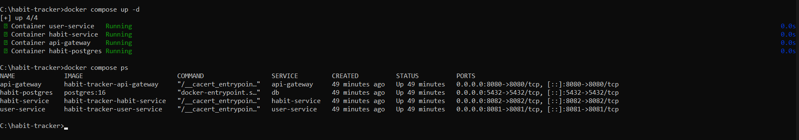
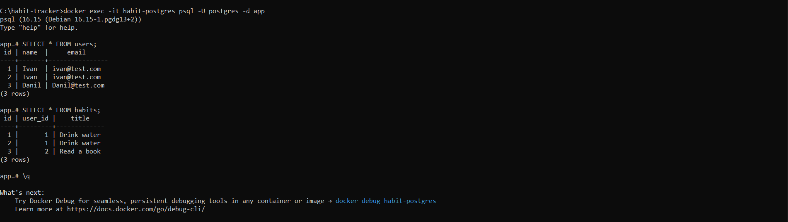

# Habit Tracker

Микросервисное приложение для отслеживания привычек: пользователи создают привычки, а система хранит их в PostgreSQL.

## Содержание

- [Архитектура](#архитектура)
- [Технологии](#технологии)
- [Структура проекта](#структура-проекта)
- [Быстрый старт](#быстрый-старт)
- [API](#api)
- [Переменные окружения](#переменные-окружения)
- [Схема базы данных](#схема-базы-данных)
- [Разработка](#разработка)
- [Скриншоты](#скриншоты)

## Архитектура

```text
Клиент -> API Gateway :8080 -> user-service  :8081 -> PostgreSQL :5432
                             -> habit-service :8082 -> PostgreSQL :5432
```

- **API Gateway** — единая точка входа: CORS, таймауты, проксирование и health-эндпоинт.
- **user-service** — создание и чтение пользователей.
- **habit-service** — создание и чтение привычек.
- **PostgreSQL** — общая база данных; схема создаётся из `db/init.sql`.

Каждый сервис — отдельное Java-приложение с собственным пулом соединений HikariCP и health-эндпоинтом.

Подробное описание по методологии C4 (Context, Container, Component) — в [docs/architecture/ARCHITECTURE.md](docs/architecture/ARCHITECTURE.md).

## Технологии

| Компонент | Версия |
|-----------|--------|
| Java | 17 |
| Javalin | 6.1.3 |
| Maven | 3.9+ |
| PostgreSQL | 16 |
| HikariCP | 5.1.0 |
| Jackson | 2.16.1 |
| JUnit 5 | 5.10.2 |
| Docker Compose | v2 |

## Структура проекта

```text
habit-tracker/
├── api-gateway/            # HTTP-шлюз
├── user-service/           # сервис пользователей
├── habit-service/          # сервис привычек
├── db/init.sql             # начальная схема БД
├── docs/architecture/      # C4-описание архитектуры
├── docker-compose.yml
├── .env.example
└── pom.xml                 # родительский POM
```

Внутри каждого сервиса код разделён на слои:

```text
src/main/java/com/habittracker/<service>/
├── <Service>Application.java  # точка входа
├── config/                    # конфигурация из переменных окружения
├── db/                        # пул соединений
├── domain/                    # модели и DTO с валидацией
├── repository/                # SQL и доступ к данным
├── error/                     # ApiException, ErrorResponse
└── web/                       # маршруты Javalin
```

## Быстрый старт

Требуется Docker Desktop с Docker Compose v2.

```bash
docker compose up -d --build
docker compose ps
```

При первом запуске PostgreSQL автоматически применит `db/init.sql`. Если база уже существовала со старой схемой, пересоздайте том:

```bash
docker compose down -v
docker compose up -d --build
```

Проверка шлюза:

```bash
curl http://localhost:8080/health
```

## API

Все запросы идут через API Gateway на `http://localhost:8080`.

| Метод | Путь | Описание | Успешный ответ |
|-------|------|----------|----------------|
| GET | `/health` | Состояние шлюза | `200 {"status":"UP"}` |
| GET | `/users` | Список пользователей | `200 [...]` |
| POST | `/users` | Создать пользователя | `201 {...}` |
| GET | `/habits` | Список привычек | `200 [...]` |
| POST | `/habits` | Создать привычку | `201 {...}` |

### Примеры

Создать пользователя:

```bash
curl -X POST http://localhost:8080/users \
  -H "Content-Type: application/json" \
  -d '{"name":"Ivan","email":"ivan@test.com"}'
```

Ответ:

```json
{"id":1,"name":"Ivan","email":"ivan@test.com"}
```

Получить пользователей:

```bash
curl http://localhost:8080/users
```

Создать привычку:

```bash
curl -X POST http://localhost:8080/habits \
  -H "Content-Type: application/json" \
  -d '{"userId":1,"title":"Drink water"}'
```

Ответ:

```json
{"id":1,"userId":1,"title":"Drink water"}
```

Получить привычки:

```bash
curl http://localhost:8080/habits
```

### Ошибки

Ошибки возвращаются в едином JSON-формате:

```json
{"error":"Field 'email' must be a valid email address"}
```

| Код | Когда возникает |
|-----|-----------------|
| 400 | Некорректный JSON или не прошла валидация |
| 404 | Маршрут не найден |
| 409 | Пользователь с таким email уже существует |
| 422 | Указанный `userId` не существует |
| 502 / 504 | Недоступен или не ответил внутренний сервис |

## Переменные окружения

| Переменная | Сервис | По умолчанию | Назначение |
|------------|--------|--------------|------------|
| `PORT` | все | 8080 / 8081 / 8082 | Порт HTTP |
| `DB_URL` | user, habit | `jdbc:postgresql://localhost:5432/app` | JDBC URL |
| `DB_USER` | user, habit | `postgres` | Пользователь БД |
| `DB_PASS` | user, habit | `1234` | Пароль БД |
| `DB_POOL_SIZE` | user, habit | `10` | Размер пула HikariCP |
| `DB_CONNECTION_TIMEOUT_MS` | user, habit | `5000` | Таймаут получения соединения |
| `USER_SERVICE_URL` | gateway | `http://localhost:8081` | Адрес user-service |
| `HABIT_SERVICE_URL` | gateway | `http://localhost:8082` | Адрес habit-service |
| `REQUEST_TIMEOUT_SECONDS` | gateway | `10` | Таймаут запроса к сервису |
| `CORS_ALLOWED_ORIGIN` | gateway | `*` | Разрешённый origin |

Для локального запуска скопируйте `.env.example` в `.env` и измените значения.

## Схема базы данных

```sql
users (id, name, email UNIQUE)
habits (id, user_id -> users.id ON DELETE CASCADE, title)
```

Индекс `idx_habits_user_id` ускоряет выборку привычек по пользователю.

## Разработка

Сборка всех модулей:

```bash
mvn clean package
```

Тесты:

```bash
mvn test
```

Запуск сервиса локально (пример для user-service):

```bash
mvn -pl user-service -am package
java -jar user-service/target/user-service-1.0-SNAPSHOT.jar
```

Для локального запуска нужен PostgreSQL на `localhost:5432` с базой `app` и схемой из `db/init.sql`.

## Скриншоты

- **Запуск Docker Compose:** 
- **Проверка API:** 
- **Данные в PostgreSQL:** 
