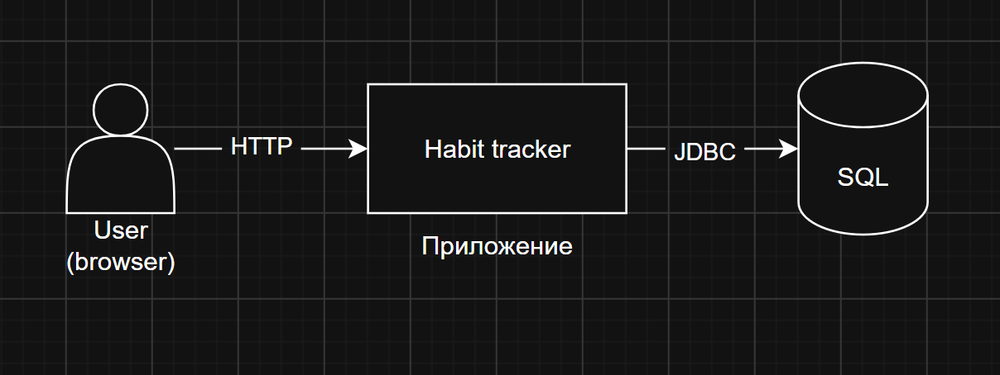
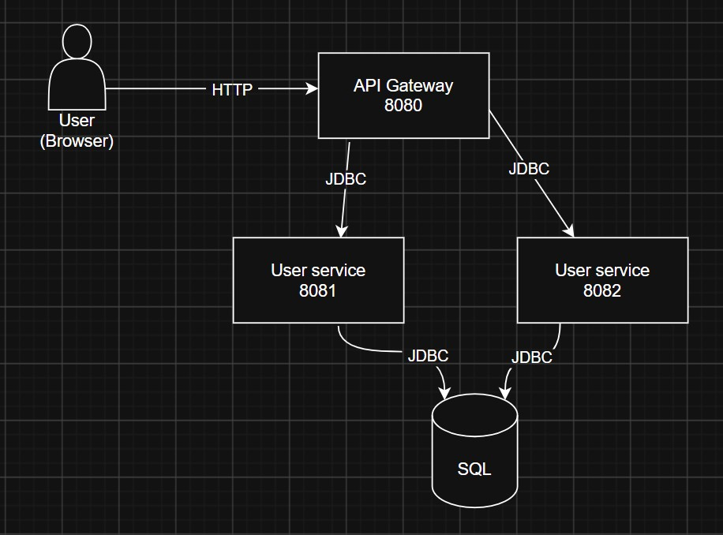
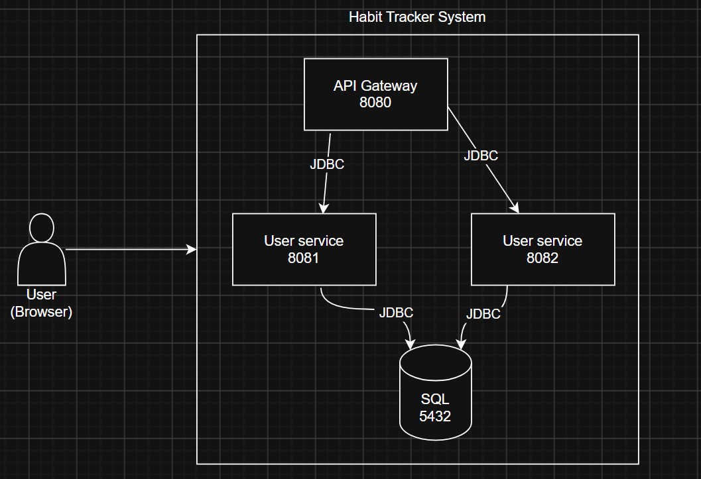

# Архитектура Habit Tracker

Документ описывает архитектуру системы по методологии **C4** (Context → Container → Component).
Каждый уровень даёт свой взгляд на систему: от внешнего окружения до внутренних компонентов одного сервиса.

Содержание:

- [Уровень 1: System Context](#уровень-1-system-context)
- [Уровень 2: Container](#уровень-2-container)
- [Уровень 3: Component](#уровень-3-component)
- [Словарь терминов](#словарь-терминов)

---

## Уровень 1: System Context

**Цель уровня** — показать систему целиком и всех, кто с ней взаимодействует. Здесь система — «чёрный ящик».

| Элемент | Тип | Описание |
|---------|-----|----------|
| User | Person | Человек, который создаёт пользователей и привычки через HTTP API |
| Habit Tracker System | Software System | Система отслеживания привычек |

Пользователь отправляет HTTP-запросы (JSON) в API Gateway. Gateway проксирует их к нужному сервису. Сервисы пишут данные в PostgreSQL.

---

## Уровень 2: Container

**Цель уровня** — разложить систему на самостоятельно запущенные процессы (контейнеры). Каждый блок можно запустить на своём сервере.

| Container | Порт | Технология | Ответственность |
|-----------|------|-----------|-----------------|
| API Gateway | 8080 | Java 17 + Javalin | Единая точка входа, проксирование, CORS, health |
| User Service | 8081 | Java 17 + Javalin + HikariCP | CRUD пользователей |
| Habit Service | 8082 | Java 17 + Javalin + HikariCP | CRUD привычек |
| PostgreSQL | 5432 | Docker image `postgres:16` | Хранение данных |

Сервисы общаются друг с другом через HTTP. Каждый сервис держит свой пул соединений к базе данных (HikariCP).

---

## Уровень 3: Component

**Цель уровня** — показать, из чего состоит внутренний код одного сервиса.
Ниже — структура **User Service**. У Habit Service структура идентична (меняются только имена сущностей и SQL).

| Компонент | Пакет | Задача |
|-----------|-------|--------|
| `UserServiceApplication` | `com.habittracker.user` | Запуск, DI-цепочка, регистрация маршрутов и обработчиков |
| `AppConfig` | `config` | Типизированное чтение настроек из переменных окружения |
| `Database` | `db` | Пул соединений HikariCP, health-check |
| `User` | `domain` | Record ответа клиенту (id, name, email) |
| `CreateUserRequest` | `domain` | Record запроса + валидация |
| `UserRepository` | `repository` | SQL-запросы: findAll, create |
| `UserController` | `web` | HTTP-маршруты GET/POST `/users` |
| `ApiException` | `error` | Непроверяемое исключение с HTTP-статусом |
| `ErrorResponse` | `error` | Единый формат ошибок: `{"error":"..."}` |

---

## Словарь терминов

| Термин | Значение |
|--------|----------|
| **C4** | Методология визуализации архитектуры из 4 уровней: Code, Component, Container, Context |
| **Container** | Самостоятельно запущенный процесс (не путать с Docker-контейнером) |
| **Component** | Логическая часть кода внутри одного контейнера (пакет/класс) |
| **HikariCP** | Пул соединений к БД |
| **Javalin** | Минималистичный веб-фреймворк для Java |
| **DTO** | Data Transfer Object — модель данных для обмена между слоями |
