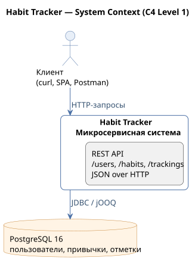
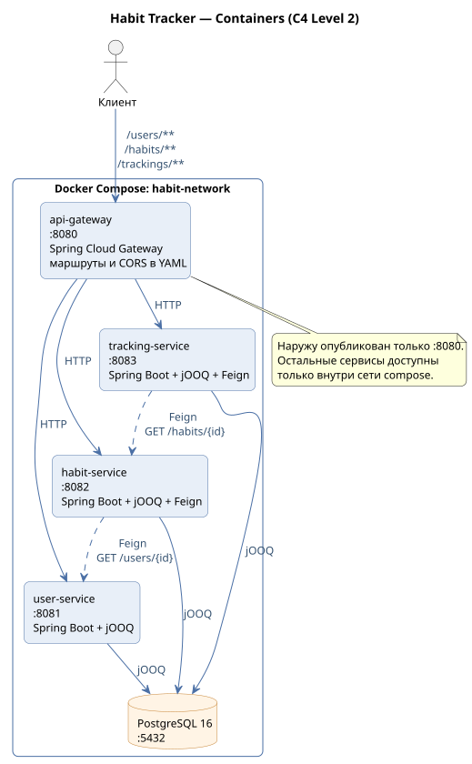
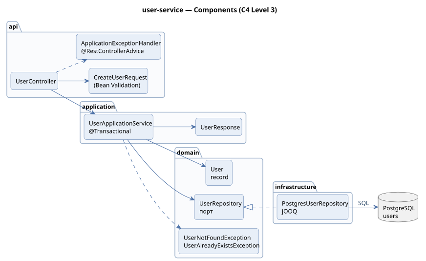
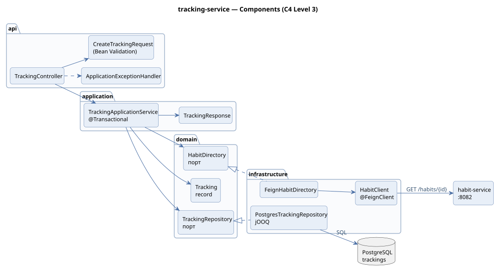
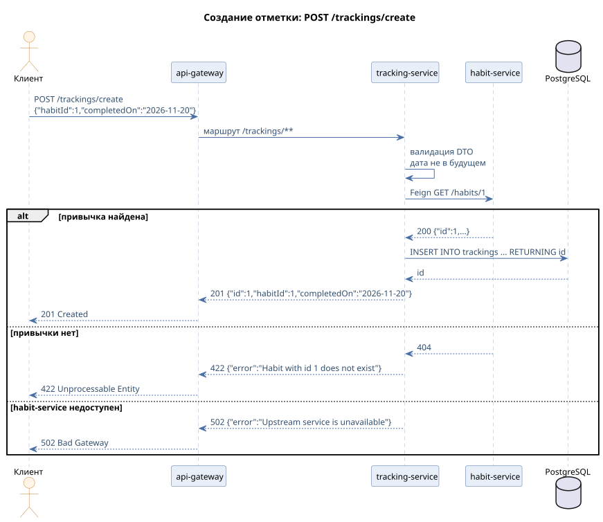

# Архитектура Habit Tracker

Описание системы по методологии **C4**: от внешнего окружения до внутренних компонентов сервиса.

Все диаграммы — **PlantUML**. Исходники лежат в [`diagrams/`](diagrams), готовые SVG — рядом с ними.

Содержание:

- [Уровень 1: System Context](#уровень-1-system-context)
- [Уровень 2: Container](#уровень-2-container)
- [Уровень 3: Component](#уровень-3-component)
- [Динамика: создание отметки](#динамика-создание-отметки)
- [Правила зависимостей между слоями](#правила-зависимостей-между-слоями)
- [Как обновить диаграммы](#как-обновить-диаграммы)
- [Словарь терминов](#словарь-терминов)

---

## Уровень 1: System Context

**Цель** — показать систему целиком: кто её использует и с чем она связана.



| Элемент | Тип | Описание |
|---------|-----|----------|
| Клиент | Person / System | SPA, curl или Postman — отправляет HTTP-запросы с JSON |
| Habit Tracker | Software System | Отслеживание привычек: пользователи, привычки, отметки выполнения |
| PostgreSQL 16 | External System | Единственное хранилище данных |

Клиент работает только через единую точку входа — API Gateway на порту `8080`.

---

## Уровень 2: Container

**Цель** — разложить систему на самостоятельно запускаемые процессы.



| Контейнер | Порт | Технологии | Ответственность |
|-----------|------|-----------|-----------------|
| api-gateway | 8080 | Spring Cloud Gateway | Маршруты `/users/**`, `/habits/**`, `/trackings/**`, CORS, таймауты |
| user-service | 8081 | Spring Boot + jOOQ | Пользователи: создание, список, чтение по id |
| habit-service | 8082 | Spring Boot + jOOQ + OpenFeign | Привычки; проверяет пользователя в user-service |
| tracking-service | 8083 | Spring Boot + jOOQ + OpenFeign | Отметки выполнения; проверяет привычку в habit-service |
| postgres | 5432 | `postgres:16` | Единая БД, схема из `db/init.sql` |

Синхронные взаимодействия:

| Откуда | Куда | Протокол | Зачем |
|--------|------|----------|-------|
| Клиент | api-gateway | HTTP/JSON | Все запросы |
| api-gateway | сервисы | HTTP | Маршрутизация по префиксу пути |
| habit-service | user-service | Feign `GET /users/{id}` | Не создать привычку несуществующему пользователю |
| tracking-service | habit-service | Feign `GET /habits/{id}` | Не отметить несуществующую привычку |

Наружу опубликован только `8080`. Остальные контейнеры доступны лишь внутри сети `habit-network`,
порт БД на хост не проброшен. Каждый сервис держит собственный пул HikariCP
и отвечает на `/actuator/health`.

---

## Уровень 3: Component

**Цель** — показать внутреннее устройство одного контейнера. Слои у всех сервисов одинаковые,
меняются только сущности и адаптеры.

### user-service



| Компонент | Пакет | Задача |
|-----------|-------|--------|
| `UserController` | `api` | Маршруты `GET /users`, `GET /users/{id}`, `POST /users/create` |
| `CreateUserRequest` | `api.dto` | Bean Validation: обязательные поля, формат email, длины |
| `ApplicationExceptionHandler` | `api.error` | `@RestControllerAdvice`: доменные исключения → HTTP-статусы, формат `{"error":"..."}` |
| `UserApplicationService` | `application` | Сценарии, `@Transactional`, маппинг в `UserResponse` |
| `UserResponse` | `application.dto` | Модель ответа; контроллер ничего не маппит |
| `User` | `domain.model` | Агрегат `(id, name, email)` |
| `UserRepository` | `domain.repository` | Порт хранилища |
| `PostgresUserRepository` | `infrastructure.persistence` | Адаптер jOOQ на сгенерированных таблицах |

### tracking-service



| Компонент | Пакет | Задача |
|-----------|-------|--------|
| `TrackingController` | `api` | `GET /trackings`, `GET /trackings?habitId=`, `POST /trackings/create` |
| `TrackingApplicationService` | `application` | Проверка даты, обращение к справочнику привычек, запись |
| `Tracking` | `domain.model` | Агрегат `(id, habitId, completedOn)` |
| `TrackingRepository` | `domain.repository` | Порт хранилища |
| `HabitDirectory` | `domain.port` | Порт «существует ли привычка» — домен не знает про HTTP |
| `PostgresTrackingRepository` | `infrastructure.persistence` | Адаптер jOOQ для `trackings` |
| `HabitClient` + `FeignHabitDirectory` | `infrastructure.client` | Feign-клиент и его адаптер к доменному порту |

`habit-service` устроен так же, только вместо `HabitDirectory` — `UserDirectory` → `UserClient` к user-service.

---

## Динамика: создание отметки

Сценарий `POST /trackings/create` с тремя исходами: успех, несуществующая привычка, недоступный habit-service.



| Исход | Код | Что происходит |
|-------|-----|----------------|
| Успех | 201 | Запись в БД через jOOQ `INSERT ... RETURNING id` |
| Привычки нет | 422 | Feign получил 404 → `HabitNotExistsException` |
| Привычка уже отмечена сегодня | 409 | Нарушено `UNIQUE (habit_id, completed_on)` |
| habit-service недоступен | 502 | `FeignException` → `HabitServiceUnavailableException` |
| Дата в будущем | 400 | Доменное правило: допуск +1 день на часовые пояса |

---

## Правила зависимостей между слоями

```text
api  ──►  application  ──►  domain
                              ▲
infrastructure ───────────────┘
```

- `domain` не зависит ни от чего: ни от Spring, ни от jOOQ, ни от Feign.
- `application` знает домен и порты, но не знает адаптеры.
- `infrastructure` реализует порты домена (jOOQ, Feign).
- `api` — тонкий адаптер: маршруты, валидация входа, отдача готовых DTO.

Контроллеры не содержат бизнес-логики и маппинга: ими занимается `application`.

---

## Как обновить диаграммы

Исходники лежат в `docs/architecture/diagrams/*.puml` и не требуют установки Graphviz —
используется встроенный layout Smetana.

Отрисовать в SVG после правки:

```bash
java -jar plantuml.jar -tsvg docs/architecture/diagrams
```

В VS Code удобнее расширение **PlantUML** (превью по `Alt+D`).
Сгенерированные `.svg` коммитятся вместе с `.puml`, чтобы диаграммы отображались на GitHub.

---

## Словарь терминов

| Термин | Значение |
|--------|----------|
| **C4** | Методология описания архитектуры: Context → Container → Component → Code |
| **Container** | Самостоятельно запущенный процесс (не путать с Docker-контейнером) |
| **Component** | Логическая часть кода внутри контейнера (пакет/класс) |
| **Port / Adapter** | Интерфейс в домене и его реализация в инфраструктуре |
| **jOOQ** | Типобезопасный SQL; таблицы генерируются из `db/init.sql` на сборке |
| **Feign** | Декларативный HTTP-клиент Spring Cloud |
| **HikariCP** | Пул соединений к БД (автоконфигурация Boot) |
| **Actuator** | Эндпоинты `/actuator/health`, `/actuator/info` для healthcheck'ов |
| **DTO** | Data Transfer Object — модель обмена между слоями |
